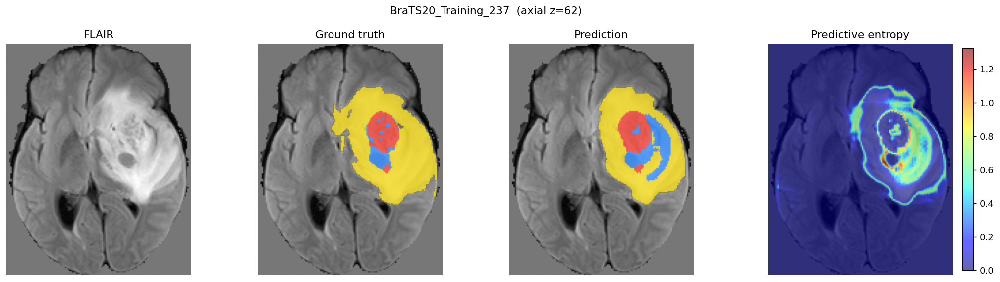
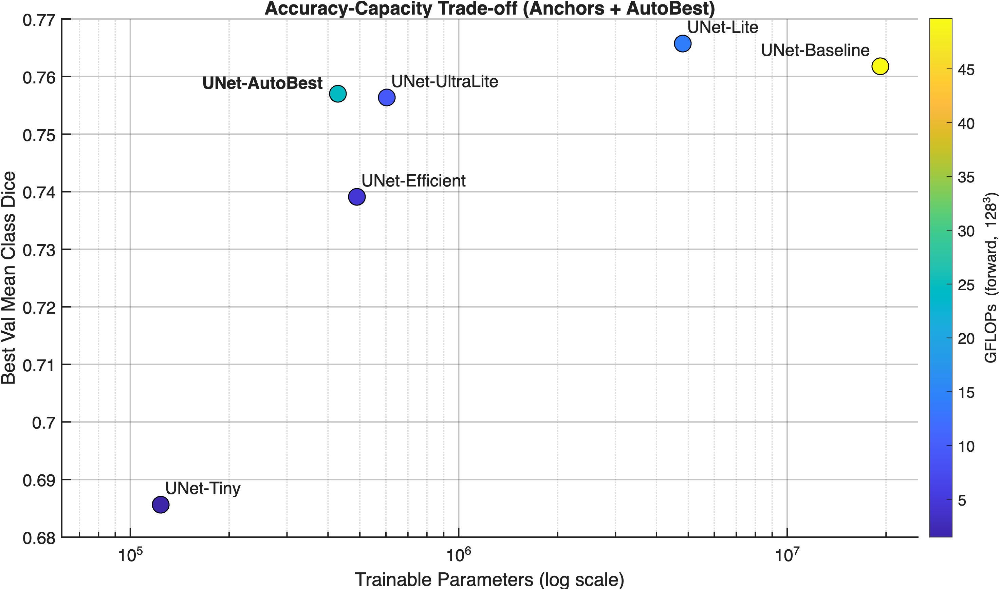
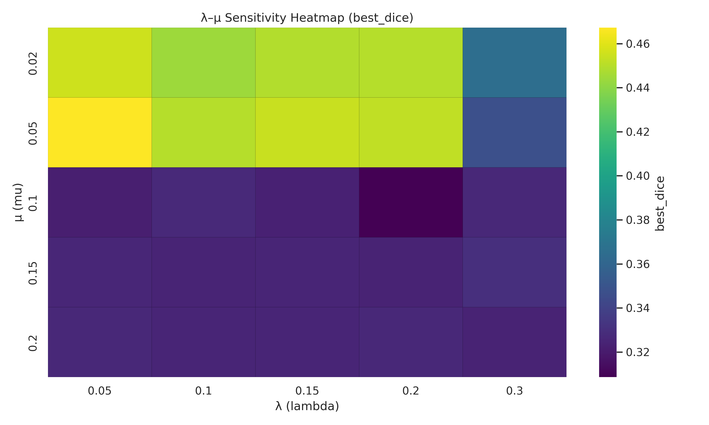

# btseg-autobest-unet

**Lightweight 3D U-Net architecture search and uncertainty estimation for glioma segmentation on BraTS 2020.** PyTorch + MONAI.

B.Sc. graduation project (EE491/EE492), Electrical & Electronics Engineering, Boğaziçi University, June 2026.

📄 **[Technical report (PDF, 5 pages)](docs/technical-report.pdf)** — method, λ–μ sensitivity analysis, full results and limitations.



*FLAIR input, ground truth, prediction, and per-voxel predictive entropy for a held-out validation case. Uncertainty concentrates on the tumour boundary and on the enhancing/necrotic interface — exactly where the model's errors are.*

---

## TL;DR

A cost-aware architecture search over 3D U-Net configurations finds **UNet-AutoBest** — a 3-level network with 429 K parameters that reaches **0.852 mean region Dice**, against **0.857 for a 19.2 M-parameter baseline**. That is **45× fewer parameters for a 0.005 Dice drop**. Replacing every convolution with a depthwise-separable one shrinks it further to **100 K parameters (191× smaller, 9× fewer FLOPs)** at 0.813 Dice. MC-dropout on the compressed model yields calibrated uncertainty maps: **QU-BraTS score 2.650, ECE 0.011**.

**The 45× saving is in parameters, not in compute.** AutoBest's 3-level encoder downsamples less, so its feature maps stay large: it costs 24.6 GFLOPs against the baseline's 49.7 — a 2× reduction, and 2.6× *more* than the 604 K-parameter UNet-UltraLite. Storage and memory shrink by 45×; arithmetic does not. The depthwise-separable variant is where the compute saving actually lands (5.54 GFLOPs, 9× below baseline).

---

## Results

All numbers are on a fixed 80/20 case-level split of the BraTS 2020 training set (**294 train / 74 validation**), seed 42, no cross-validation. Dice is reported on the standard nested BraTS regions — whole tumour (WT), tumour core (TC), enhancing tumour (ET). GFLOPs are a forward pass at 128³ with 4 input channels.

### Anchors and the searched architecture

| Model | Params | GFLOPs | WT | TC | ET | **Mean region** | Mean class | Train time |
|---|---:|---:|---:|---:|---:|---:|---:|---:|
| UNet-Baseline `(32,64,128,256,512)` | 19,225,897 | 49.66 | 0.903 | 0.873 | 0.793 | **0.857** | 0.762 | 6.2 h |
| UNet-Lite `(16,32,64,128,256)` | 4,811,129 | 14.07 | 0.907 | 0.875 | 0.809 | **0.864** | 0.766 | 7.2 h |
| UNet-UltraLite `(16,32,64,128)` | 603,649 | 9.42 | 0.902 | 0.863 | 0.799 | 0.854 | 0.756 | 6.8 h |
| UNet-Efficient `(16,32,64,128)`, no res-units | 489,322 | 4.57 | 0.896 | 0.854 | 0.774 | 0.841 | 0.739 | 7.6 h |
| UNet-Tiny `(8,16,32,64)` | 123,706 | 1.49 | 0.877 | 0.819 | 0.738 | 0.811 | 0.686 | 7.4 h |
| **UNet-AutoBest** `(24,32,80)` — *searched* | **428,553** | 24.60 | 0.901 | 0.869 | 0.786 | **0.852** | 0.757 | **4.0 h** |
| **UNet-AutoBest-DSConv** — *depthwise separable* | **100,477** | 5.54 | 0.877 | 0.819 | 0.744 | 0.813 | 0.707 | 4.6 h |

> **Two Dice conventions appear in this repo, so both are given above.** *Mean region* Dice averages the nested BraTS regions WT/TC/ET and is the number to compare against the literature. *Mean class* Dice averages the three raw label classes (necrotic core, oedema, enhancing tumour) and is what the training scripts optimise and log as `best_val_mean_class_dice` — it is also the quantity plotted on the y-axis of every figure below. Region Dice is always higher because WT is an easy union of all three classes.

Raw per-run records, including learning-rate schedules, best/final epochs and wall-clock times, are in [`results/`](results/). The train/validation split itself is committed at [`results/splits/`](results/splits/) so the numbers can be checked against exactly the cases they were computed on.

> **Empty-region convention.** Following BraTS practice, a region with no voxels in *either* the prediction or the ground truth scores Dice = 1, while a non-empty prediction against an empty ground truth scores 0. This mainly affects ET: 1 of the 74 validation cases (`BraTS20_Training_264`) has no enhancing tumour on either side and therefore contributes a 1.0 to the ET average. Three further cases score below 0.01 on ET.



Two things stand out. First, the baseline is heavily over-parameterised for this task — UNet-Lite matches it with a quarter of the weights, and beats it on ET. Second, the searched model lands where no hand-designed anchor does: it holds UltraLite-level accuracy at 71 % of its parameters, and does so with a **3-level** encoder rather than 4, which no anchor in the sweep used.

### Uncertainty (MC dropout, T = 20, 74 validation cases)

These numbers come from a **separately trained, dropout-enabled copy** of the DSConv model (`train_autobest_dsconv_mc.py`), not from the deterministic row above. That is why its Dice (0.818) differs slightly from the DSConv row (0.813) — different training run, same architecture and pipeline.

| Metric | Value |
|---|---:|
| Mean region Dice | 0.818 |
| QU-BraTS score (mean) | **2.650** |
| — WT / TC / ET | 2.753 / 2.630 / 2.568 |
| Expected calibration error | **0.011** |
| Uncertainty–error Spearman (voxel) | 0.224 |
| Uncertainty–error Spearman (case) | 0.114 |

The QU-BraTS score is the BraTS 2020 Task 3 metric, reimplemented here as `AUC(Dice vs T) + (1 − AUC(FTP vs T)) + (1 − AUC(FTN vs T))`, where `T` sweeps uncertainty percentiles and progressively filters out the least confident voxels. A perfect score is 3.

Calibration is good (ECE ≈ 1 %) and voxel-level uncertainty correlates with error, but the case-level correlation is weak (ρ = 0.11) — per-voxel entropy does **not** reliably tell you which *patient* the model got wrong. That is a known limitation of MC dropout rather than a bug, and it is the main thing worth reporting honestly here.

---

## Method

### 1. Baselines

Five hand-designed 3D U-Net variants spanning 124 K – 19.2 M parameters, all trained with an identical pipeline: RAS orientation, 1 mm isotropic resampling, non-zero z-score normalisation, foreground cropping, 128³ positive/negative-balanced random crops, flips + 90° rotations + affine jitter, `DiceCELoss`, AdamW with cosine annealing, 100 epochs max with early stopping at patience 20.

### 2. Cost-aware architecture search

The search maximises

```
score(a) = Dice(a) − λ · log(params(a)/1e6 + 1) − μ · log(GFLOPs(a) + 1)
```

over a space of channel widths (multipliers 0.70–1.40, rounded to multiples of 8, strictly increasing), encoder depth (3–5 levels), and residual units per block (0–2). Strides are fixed at 2 between levels.

Because `λ` and `μ` decide the whole answer, they are not guessed — the search is run over the full 5 × 5 grid `λ ∈ {0.05, 0.10, 0.15, 0.20, 0.30}` × `μ ∈ {0.02, 0.05, 0.10, 0.15, 0.20}`, with every candidate trained at short proxy fidelity, and the resulting best-spec surface is inspected directly:



The surface is informative, and it is the reason the final search is run where it is. For `μ ≥ 0.10` every cell collapses to proxy Dice ≈ 0.32 and the search returns the *same* tiny 5-level network `(8,16,32,64,120)` regardless of `λ` — the FLOP penalty swamps the accuracy term, so the search stops discriminating. Only the `μ ≤ 0.05` band produces architectures that trade capacity against accuracy in a useful way, and within it `λ` has a mild effect until `λ = 0.30`, where the penalty starts biting again (the dark right-hand column). The final dense search therefore runs at `λ = 0.05, μ = 0.02`, the top 10 candidates are retrained at full fidelity and re-ranked, and the winner is written to [`results/search/best_spec.json`](results/search/best_spec.json):

```json
{"channels": [24, 32, 80], "strides": [2, 2], "num_res_units": 2}
```

Two details matter for reading the proxy numbers. Candidates are trained for only 10 epochs **and on a fixed 30 % subset of the 294 training cases**, not the full split — that combination, rather than the epoch budget alone, is why proxy Dice sits at 0.30–0.55 against a converged 0.85. The dense run evaluated 42 candidates across 6 iterations of local moves (full trace in [`results/search/final_search_trials.csv`](results/search/final_search_trials.csv)), and the top ten were then re-evaluated on the *full* training split before the final ranking — precisely because subset proxy scores are good enough to shortlist but not to order. `src/auto_search.py` then emits a standalone training script for the winning spec (`src/generated_best_model_train.py`) — the search's output is runnable code, not just a config.

### 3. Depthwise-separable compression

Every `Conv3d` inside the encoder/decoder residual blocks of the winning topology is replaced with depthwise (`groups=in_channels`) + pointwise (1×1×1) convolutions. Everything else — split, pipeline, loss, schedule, augmentation — is held fixed, so the 0.039 mean-Dice drop is attributable to the operator change alone.

> **Note on code reuse.** `train_autobest_dsconv.py` does not import `train_variants.py`; it duplicates roughly 250 lines of the engine (data list, split, transforms, metrics, training loop). The two copies were checked and agree on every hyperparameter that affects training — loss, optimiser, scheduler, augmentation probabilities, crop sampling, split fraction — so the controlled comparison holds for the published results. But that equivalence is maintained by hand rather than enforced by the code, and would need re-checking after any edit to either file.

### 4. Uncertainty estimation

Dropout is inserted into the compressed model and kept stochastic at inference. Twenty forward passes per case give a predictive distribution; per-region predictive Bernoulli entropy (normalised by log 2) is the uncertainty map. Evaluated with QU-BraTS, ECE over 15 bins, and Spearman correlation between uncertainty and error at both voxel and case level.

---

## Repository layout

```
src/
  train_variants.py             # shared engine: data, transforms, split, train loop, metrics
                                #   imported as `base` by auto_search.py,
                                #   train_autobest_dsconv_mc.py, eval_mc_dropout.py
                                #   and export_preds_*.py
  auto_search.py                # cost-aware architecture search + code generation
  generated_best_model_train.py # emitted by auto_search.py for the winning spec
  train_autobest_dsconv.py      # depthwise-separable variant of the winning spec
  train_autobest_dsconv_mc.py   #   ... with dropout, for MC sampling
  eval_mc_dropout.py            # MC-dropout inference, QU-BraTS, ECE, Spearman
  plot_uncertainty_figures.py   # uncertainty report figures
  evaluate.py                   # evaluate a checkpoint on the validation split
  export_preds_15cases.py       # write NIfTI predictions for the viewer
  make_figures.py               # search / trade-off figures from results/*.csv
viewer/
  BtSegViewer.py                # napari GUI: FLAIR + ground truth + prediction overlay
configs/default.yaml            # every hyperparameter used to produce results/
results/                        # all experiment CSVs (search trials, anchors, uncertainty)
docs/figures/                   # figures used in this README
```

The scripts in `src/` import each other as flat sibling modules (`import train_variants as base`), which is how they were run on the lab machine. Run them from inside `src/`.

---

## Installation

```bash
git clone https://github.com/tahsinaydin02/btseg-autobest-unet.git
cd btseg-autobest-unet
python -m venv .venv && source .venv/bin/activate
pip install -r requirements.txt

# optional, only for the napari viewer
pip install -r requirements-viewer.txt
```

Developed with Python 3.10 on a single CUDA GPU. The exact torch and MONAI versions used for the published runs were not recorded at the time, so `requirements.txt` gives compatible ranges rather than a verified lock file — treat it as a starting point, not a reproduction guarantee. A GPU is required for training; inference on CPU works but is slow.

## Data

BraTS 2020 is **not** included in this repository and cannot be redistributed — it is released under a data use agreement that forbids it. Request access and download it yourself:

- Registration: <https://www.med.upenn.edu/cbica/brats2020/registration.html>
- The training set is also mirrored on Kaggle for registered users.

Point the code at your copy:

```bash
export BRATS_DATA_ROOT=/path/to/MICCAI_BraTS2020_TrainingData
```

Expected layout:

```
MICCAI_BraTS2020_TrainingData/
  BraTS20_Training_001/
    BraTS20_Training_001_flair.nii
    BraTS20_Training_001_t1.nii
    BraTS20_Training_001_t1ce.nii
    BraTS20_Training_001_t2.nii
    BraTS20_Training_001_seg.nii
  BraTS20_Training_002/
  ...
```

Labels `{0,1,2,4}` are remapped internally to `{0,1,2,3}`.

> **One case is dropped, by design of the data rather than by choice.** The dataset ships 369 case folders, but `BraTS20_Training_355` stores its segmentation as `W39_1998.09.19_Segm.nii` instead of `BraTS20_Training_355_seg.nii`. `build_datalist()` pairs modalities by filename, fails to find a label for that case, and skips it with a printed warning (`Missing modality, skipped: BraTS20_Training_355`). **Every number in this repository is therefore computed over 368 usable cases, split 294 / 74.** If you rename that file before running, you will get 369 cases and a split that no longer matches [`results/splits/`](results/splits/).

## Running

```bash
cd src

# 1. train the hand-designed anchors
python train_variants.py

# 2. run the architecture search (long; writes auto_search_out/)
python auto_search.py

# 3. train the winning spec, then its depthwise-separable version
python generated_best_model_train.py
python train_autobest_dsconv.py

# 4. train the dropout variant and evaluate uncertainty
python train_autobest_dsconv_mc.py
python eval_mc_dropout.py

# evaluate a checkpoint on the validation split.
# A state_dict carries no architecture, so the spec must be supplied with it.
BTSEG_CKPT=brats2020_unet_UNet-AutoBest_best_80_20.pth \
BTSEG_SPEC='{"channels":[24,32,80],"strides":[2,2],"num_res_units":2}' \
BTSEG_VAL_TXT=../results/splits/val_cases_seed42.txt \
python evaluate.py

# for the depthwise-separable models, add:  BTSEG_DSCONV=1

# regenerate the figures in docs/ from the committed CSVs
python make_figures.py
```

The napari viewer expects NIfTI predictions produced by `export_preds_15cases.py`:

```bash
python export_preds_15cases.py
python ../viewer/BtSegViewer.py
```

## Reproducibility

Seed 42 is set for Python, NumPy, PyTorch and the DataLoader workers, and the train/validation split is written to disk so it can be reused. `STRICT_GPU_DETERMINISM` is left `False` — `cudnn.benchmark` stays on for speed, so GPU runs reproduce to within a few thousandths of Dice rather than bit-exactly. Set it to `True` in `train_variants.py` for strict determinism at a substantial speed cost.

Model weights are not committed. The three trained models discussed here are published under the [v1.0 release](../../releases/tag/v1.0): `UNet-AutoBest` (1.7 MB), `UNet-AutoBest-DSConv` (416 KB) and the dropout-enabled `UNet-AutoBest-DSConv-MC` (416 KB), together with the validation split. The release notes give the architecture spec of each file, which `evaluate.py` needs — a `state_dict` does not carry its own architecture.

## Limitations

- One case (`BraTS20_Training_355`) is excluded because of a filename mismatch in the released dataset, so results cover 368 of the 369 cases. The effect on aggregate Dice is negligible, but it is a difference from work that reports on all 369.
- Single fixed 80/20 split, one seed. No cross-validation, so the differences of ~0.005 Dice between the top models are within noise and should not be read as a ranking.
- Validation is the held-out 20 % of the BraTS 2020 *training* set. Numbers are therefore not comparable to official BraTS leaderboard scores, which use a separate hidden test set.
- The search's proxy fidelity (a handful of epochs) ranks candidates well enough to shortlist them, but proxy Dice is far below converged Dice — see the gap between `results/search/*_trials.csv` and the final table above.
- Case-level uncertainty is weakly correlated with case-level error, so these maps support voxel-level triage, not automatic case rejection.

## Citation

If you use this code, please cite the BraTS dataset papers and MONAI:

```bibtex
@article{menze2015brats,
  title   = {The Multimodal Brain Tumor Image Segmentation Benchmark (BRATS)},
  author  = {Menze, Bjoern H and Jakab, Andras and Bauer, Stefan and others},
  journal = {IEEE Transactions on Medical Imaging},
  volume  = {34}, number = {10}, pages = {1993--2024}, year = {2015}
}

@article{bakas2017advancing,
  title   = {Advancing The Cancer Genome Atlas glioma MRI collections with expert
             segmentation labels and radiomic features},
  author  = {Bakas, Spyridon and Akbari, Hamed and Sotiras, Aristeidis and others},
  journal = {Scientific Data}, volume = {4}, pages = {170117}, year = {2017}
}

@article{bakas2018identifying,
  title   = {Identifying the Best Machine Learning Algorithms for Brain Tumor
             Segmentation, Progression Assessment, and Overall Survival Prediction
             in the BRATS Challenge},
  author  = {Bakas, Spyridon and Reyes, Mauricio and Jakab, Andras and others},
  journal = {arXiv:1811.02629}, year = {2018}
}

@article{cardoso2022monai,
  title   = {MONAI: An open-source framework for deep learning in healthcare},
  author  = {Cardoso, M Jorge and Li, Wenqi and Brown, Richard and others},
  journal = {arXiv:2211.02701}, year = {2022}
}
```

The uncertainty evaluation follows the QU-BraTS protocol of Mehta et al., *"QU-BraTS: MICCAI BraTS 2020 Challenge on Quantifying Uncertainty in Brain Tumor Segmentation"*, MELBA 2022.

## License

Code is released under the [MIT License](LICENSE). The BraTS 2020 dataset is not covered by it and is subject to its own data use agreement.

## Acknowledgements

Developed as an EE491/EE492 graduation project at Boğaziçi University. Training was carried out on lab GPU hardware at BUSIM (Boğaziçi University MRI Laboratory).
